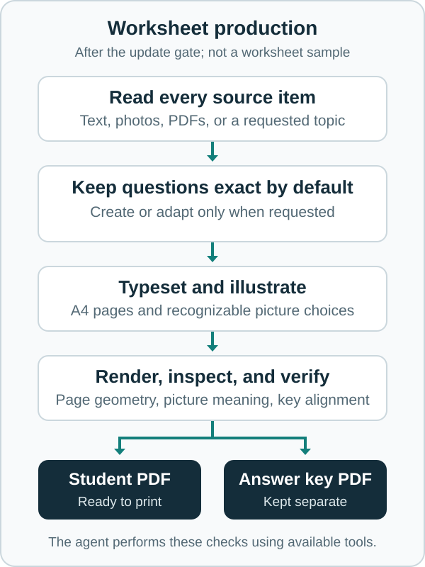

<p align="center">
  
</p>
<h1 align="center">Worksheet Maker</h1>
<p align="center"><strong>From source questions to printable practice.</strong></p>
<p align="center">An agent skill for A4 student worksheets and separate answer keys, with explicit checks for pictures, layout, and source fidelity.</p>
<p align="center">
  <a href="#quick-start">Quick start</a> ·
  <a href="docs/installation.md">Install &amp; update</a> ·
  <a href="docs/usage.md">Usage</a> ·
  <a href="#how-it-works">Workflow</a> ·
  <a href="CONTRIBUTING.md">Contributing</a>
</p>
<p align="center">Skill version 1.3.0 · Any school subject · A4 portrait by default</p>



*Worksheet production stages after the required update check. This source-backed illustration is not a generated worksheet or evidence of a PDF-generation run.*

## What it does

Worksheet Maker guides a capable AI agent through recreating supplied questions or creating practice when requested. It accepts pasted questions, worksheets, exams, photos, screenshots, and PDFs. The repository contains the instructions and plugin metadata; the agent supplies the PDF and image tools.

| Need | Instructed behavior |
|---|---|
| Recreate supplied questions | Preserve wording, values, choices, order, and activity format by default. |
| Create or adapt practice | Change content only when explicitly requested; create original questions when a topic is supplied without source questions. |
| Preserve picture tasks | Use recognizable monochrome illustrations and inspect every picture at printable scale. |
| Prepare for printing | Use A4 portrait, safe margins, readable text, and room for answers. |
| Keep answers separate | Produce an independent key and verify it against the final student PDF. |
| Review the result | Compare exact-mode text with the source and inspect all rendered pages. |

## Quick start

For a reusable installation, give your agent this prompt:

```text
Install Worksheet Maker from https://github.com/junrillg/worksheet-maker.
Read docs/installation.md and use the supported install method for this agent.
Keep a managed checkout so worksheet runs check and install updates first.
Preserve existing installations and local edits; report the active version and commit.
```

See [installation and automatic updates](docs/installation.md) for Codex, Claude Code, and managed-plugin guidance. The local clone below also works when you ask an agent to read the skill directly.

Prerequisites: Git, Python 3.9+ for the updater, and an AI agent that can read local instructions, inspect attachments, create and render PDFs, and produce or edit illustrations. The PDF checks require PyMuPDF in the agent's execution environment and an available PDF workflow. These tools are not bundled here.

```sh
git clone https://github.com/junrillg/worksheet-maker.git
cd worksheet-maker
```

Open that folder in your agent and send this prompt:

```text
Read skills/worksheet-maker/SKILL.md and use Worksheet Maker.
My request is: worksheet-maker help
```

The expected first result is the usage block only, with no attachment inspection, network access, or file creation. These are agent prompts, not shell commands. Cloning the repository does not install or register the plugin in an agent application.

Then attach your source pages and request:

```text
Use Worksheet Maker to recreate these questions as a printable worksheet.
```

The instructed output is a separate `Subject_Level_Worksheet.pdf` and `Subject_Level_Answer_Key.pdf`. To request new content, say so explicitly, for example: “Create new Kinder 2 phonics practice with a few age-appropriate challenge questions.” See [usage examples and modes](docs/usage.md).

## How it works

Before each non-help worksheet request, the agent checks the canonical repository and applies available updates, then reloads the skill. Git installations use a clean `main` checkout and fast-forward updates; managed plugins use their host's supported update mechanism. If checking or updating fails, worksheet work stops unless you explicitly choose the installed version.

The agent then reads the entire source set, maps every item or learning objective, lays out the pages, and prepares individual illustrations. It renders and inspects the PDFs, checks page geometry and source fidelity, and verifies the key against the final student PDF before delivery.

| File | Responsibility |
|---|---|
| [SKILL.md](skills/worksheet-maker/SKILL.md) | Mode selection, help, production workflow, and required quality gates. |
| [Codex plugin manifest](.codex-plugin/plugin.json) | Plugin identity and skill directory. |
| [Plugin manifest](plugin.json) | Plugin identity and interface metadata. |
| [Usage guide](docs/usage.md) | Prompts, expected outputs, and missing-information behavior. |
| [Installation guide](docs/installation.md) | Agent installation prompt, supported local paths, and update recovery. |
| [Update helper](skills/worksheet-maker/scripts/update.py) | Check the trusted repository and apply fast-forward updates for a managed Git installation. |

## Limits and verification

This is an instruction package, not a standalone worksheet application. Image recognition, source transcription, and PDF correctness depend on the agent and its available tools. The quality gates are required instructions, not an automated correctness guarantee. Unreadable source content may require clarification; ambiguous source answers must be preserved and flagged separately.

Repository validation is separate from worksheet validation. See [contribution checks](CONTRIBUTING.md) and the [presentation verification record](docs/presentation-status.md). No example worksheet PDF is included in this repository.

## Participation and terms

Use [GitHub issues](https://github.com/junrillg/worksheet-maker/issues) for reproducible problems and [CONTRIBUTING.md](CONTRIBUTING.md) for change guidance. Share synthetic examples, without student names, scores, school branding, or other private information.

No license has been selected for this repository. Public availability does not grant a reuse license; obtain the owner's permission before reuse or redistribution.
